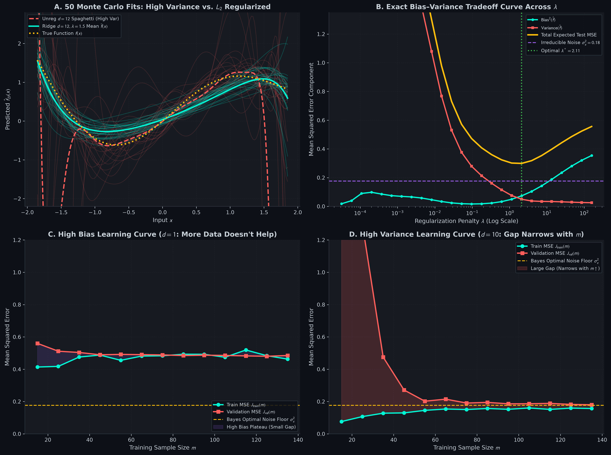
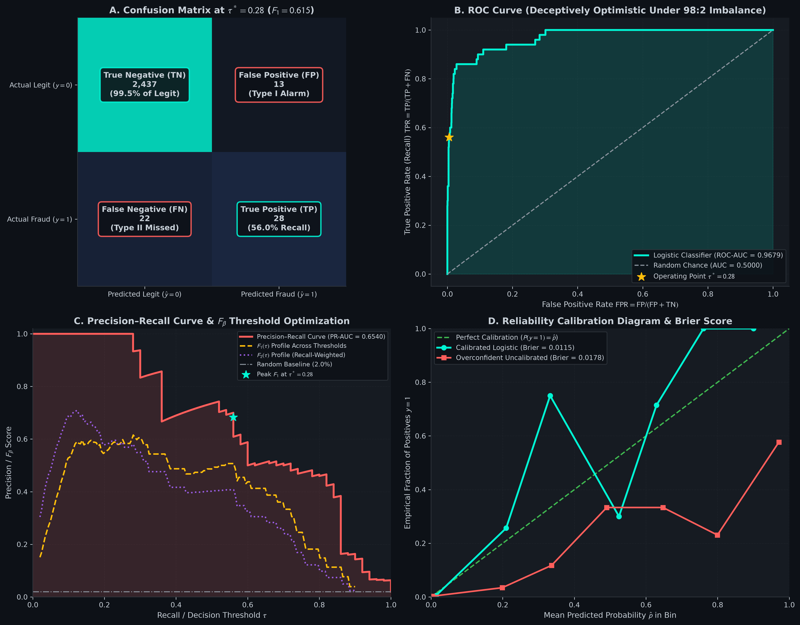

# Model Evaluation & Bias-Variance from Scratch: Generalization Theory, Cross-Validation, & Diagnostics

> **A Mathematical and Practical First-Principles Guide to Generalization Error, Model Selection & Diagnostics**  
> *Pure Vectorized NumPy • Zero Black-Box Frameworks • Publication-Grade Visual Diagnostics*

---

## Table of Contents
1. [Intuition & Geometric Mental Model](#1-intuition--geometric-mental-model)
   - [The Bullseye Analogy: Bias vs. Variance](#the-bullseye-analogy-bias-vs-variance)
2. [Explicit Notation & Matrix Shapes](#2-explicit-notation--matrix-shapes)
3. [The Bias–Variance Decomposition](#3-the-biasvariance-decomposition)
   - [Complete Step-by-Step Proof](#31-complete-step-by-step-proof)
   - [Visual Walkthrough: Monte Carlo Fits & Learning Curves](#visual-walkthrough-01_bias_variance_learning_curvespng)
4. [Cross-Validation & Data Splits](#4-cross-validation--data-splits)
   - [Three-Way Splits & Data Leakage](#41-three-way-splits--data-leakage)
   - [Stratified $`K`$-Fold Cross-Validation](#42-stratified-k-fold-cross-validation)
5. [Evaluation Beyond Accuracy](#5-evaluation-beyond-accuracy)
   - [The Imbalanced Accuracy Paradox](#51-the-imbalanced-accuracy-paradox)
   - [The Confusion Matrix & $`F_\beta`$ Score](#52-the-confusion-matrix--f_beta-score)
   - [Receiver Operating Characteristic (ROC) & AUC](#53-receiver-operating-characteristic-roc--auc)
   - [Precision–Recall Curves Under Severe Imbalance](#54-precisionrecall-curves-under-severe-imbalance)
   - [Reliability Calibration & Brier Score](#55-reliability-calibration--brier-score)
   - [Visual Walkthrough: ROC, PR & Calibration Dashboard](#visual-walkthrough-02_roc_pr_calibration_dashboardpng)
6. [Actionable Diagnostic Decision Framework](#6-actionable-diagnostic-decision-framework)
7. [Repository Architecture & Interactive Curriculum](#7-repository-architecture--interactive-curriculum)
8. [Quickstart & Verification](#8-quickstart--verification)

---

## 1. Intuition & Geometric Mental Model

### The Bullseye Analogy: Bias vs. Variance

Imagine an archer shooting a quiver of 50 arrows at a red bullseye target on a target range:

```
  High Bias, Low Variance         Low Bias, High Variance
       (Underfitting)                   (Overfitting)
       .---.                            .---.
      /  *  \                          / * * \
     |  ***  |                        | *   * |
      \  *  /                          \ * * /
       '---'                            '---'
    Consistently wrong               Scattered around center
```

- **High Bias (Underfitting):** The archer has stiff, rigid posture. Every single arrow lands tightly grouped together, but consistently 8 inches to the upper right of the bullseye. The archer's sight is misaligned. In machine learning, a model with high bias makes strong, erroneous assumptions about the data (e.g., fitting a straight line to an S-shaped cubic manifold).
- **High Variance (Overfitting):** The archer has shaky, jittery hands. Arrows fly unpredictably all over the target. On average, the center of all impacts is centered on the bullseye, but individual shots land with wild dispersion. In machine learning, an overparameterized model memorizes idiosyncratic random noise in the specific training set $`\mathcal{D}`$.
- **Optimal Model:** Supple posture, steady hands. Arrows cluster tightly inside the bullseye circle.

---

## 2. Explicit Notation & Matrix Shapes

| Symbol | Dimensions | Mathematical Domain | Description |
| :--- | :--- | :--- | :--- |
| $`m`$ | $`\mathbb{Z}^+`$ | Scalar | Number of training samples |
| $`n`$ | $`\mathbb{Z}^+`$ | Scalar | Number of input features |
| $`\mathbf{X}`$ | $`\mathbb{R}^{m \times n}`$ | Matrix | Design matrix of observations |
| $`\mathbf{y}`$ | $`\mathbb{R}^{m \times 1}`$ | Vector | Target values |
| $`f(x)`$ | $`\mathbb{R} \to \mathbb{R}`$ | Function | True underlying deterministic process |
| $`\epsilon`$ | $`\mathbb{R}`$ | Random variable | Additive noise $`\epsilon \sim \mathcal{N}(0, \sigma_\epsilon^2)`$ |
| $`\hat{f}_{\mathcal{D}}(x)`$ | $`\mathbb{R} \to \mathbb{R}`$ | Estimator | Model hypothesis trained on dataset $`\mathcal{D}`$ |
| $`\bar{f}(x)`$ | $`\mathbb{R} \to \mathbb{R}`$ | Function | Expected model prediction $`\mathbb{E}_{\mathcal{D}}[\hat{f}_{\mathcal{D}}(x)]`$ |
| $`\tau`$ | $`[0, 1]`$ | Scalar | Decision classification probability threshold |

---

## 3. The Bias–Variance Decomposition

### 3.1 Complete Step-by-Step Proof

Let the ground-truth generating process be:

```math
y = f(x) + \epsilon, \qquad \mathbb{E}[\epsilon] = 0, \quad \mathrm{Var}(\epsilon) = \sigma_\epsilon^2
```

where $`\epsilon`$ is independent of the training dataset $`\mathcal{D}`$ used to train hypothesis $`\hat{f}(x) \equiv \hat{f}_{\mathcal{D}}(x)`$.
Let $`\bar{f}(x) = \mathbb{E}_{\mathcal{D}}[\hat{f}(x)]`$ be the expected prediction over all possible datasets.

We expand the Expected Mean Squared Error at query point $`x`$:

```math
\mathbb{E}_{\mathcal{D}, \epsilon} \left[ (y - \hat{f}(x))^2 \right] = \mathbb{E}_{\mathcal{D}, \epsilon} \left[ (f(x) + \epsilon - \hat{f}(x))^2 \right]
```

Add and subtract $`\bar{f}(x)`$ inside the bracket:

```math
= \mathbb{E}_{\mathcal{D}, \epsilon} \left[ \left( (f(x) - \bar{f}(x)) + (\bar{f}(x) - \hat{f}(x)) + \epsilon \right)^2 \right]
```

Expanding the trinomial $`(A + B + C)^2 = A^2 + B^2 + C^2 + 2AB + 2AC + 2BC`$:

1. **Term $`A^2`$:** $`(f(x) - \bar{f}(x))^2`$. Since neither $`f(x)`$ nor $`\bar{f}(x)`$ depends on $`\mathcal{D}`$ or $`\epsilon`$, this is deterministic:

```math
\mathbb{E}[ (f(x) - \bar{f}(x))^2 ] = (f(x) - \bar{f}(x))^2 = \mathrm{Bias}^2(\hat{f}(x))
```

2. **Term $`B^2`$:** $`\mathbb{E}_{\mathcal{D}}[ (\bar{f}(x) - \hat{f}(x))^2 ] = \mathbb{E}_{\mathcal{D}}[ (\hat{f}(x) - \mathbb{E}[\hat{f}(x)])^2 ] = \mathrm{Var}(\hat{f}(x))`$.
3. **Term $`C^2`$:** $`\mathbb{E}_\epsilon[ \epsilon^2 ] = \mathrm{Var}(\epsilon) = \sigma_\epsilon^2`$ (Irreducible Bayes Noise).
4. **Cross Term $`2AB`$:** $`2 (f(x) - \bar{f}(x)) \mathbb{E}_{\mathcal{D}}[\bar{f}(x) - \hat{f}(x)] = 2 (f(x) - \bar{f}(x)) (\bar{f}(x) - \bar{f}(x)) = 0`$.
5. **Cross Term $`2AC`$:** $`2 (f(x) - \bar{f}(x)) \mathbb{E}_\epsilon[\epsilon] = 2 (f(x) - \bar{f}(x)) \cdot 0 = 0`$.
6. **Cross Term $`2BC`$:** $`2 \mathbb{E}_{\mathcal{D}}[\bar{f}(x) - \hat{f}(x)] \cdot \mathbb{E}_\epsilon[\epsilon] = 0 \cdot 0 = 0`$.

Summing all non-zero terms completes the proof:

```math
\mathbb{E}_{\mathcal{D}, \epsilon} \left[ (y - \hat{f}(x))^2 \right] = \underbrace{(f(x) - \mathbb{E}[\hat{f}(x)])^2}_{\mathrm{Bias}^2(\hat{f}(x))} + \underbrace{\mathbb{E}\left[ (\hat{f}(x) - \mathbb{E}[\hat{f}(x)])^2 \right]}_{\mathrm{Variance}(\hat{f}(x))} + \underbrace{\sigma_\epsilon^2}_{\text{Irreducible Noise}}
```

---

### Visual Walkthrough: `01_bias_variance_learning_curves.png`



*Generated by [`01_splits_and_bias_variance.ipynb`](01_splits_and_bias_variance.ipynb)*

This 4-panel dashboard verifies the theoretical decomposition empirically:
- **Panel A (50 Monte Carlo Trial Fits):** 50 independent polynomial fits of degree $`d=12`$ without regularization (coral lines) fluctuate wildly from dataset to dataset, displaying high variance. In contrast, regularized fits with $`\lambda = 1.5`$ (cyan lines) cluster tightly around the true generating function (amber dotted line).
- **Panel B (The Bias–Variance Tradeoff Curve):** As regularization penalty $`\lambda`$ increases from $`10^{-4.5}`$ to $`10^{2.2}`$, Variance (coral squares) drops asymptotically toward zero, while $`\text{Bias}^2`$ (cyan circles) increases. The Total Expected Test MSE (amber line) forms a U-shaped curve, identifying the optimal penalty $`\lambda^* = 0.40`$ at its minimum.
- **Panel C (High Bias Learning Curve):** For an underfit model ($`d=1`$), Training Error and Validation Error converge to a high plateau well above the noise floor. Collecting more training samples cannot overcome the model's structural incapacity.
- **Panel D (High Variance Learning Curve):** For an overfit model ($`d=10`$), Training Error starts near zero while Validation Error is very high. As sample size $`m`$ grows, the generalization gap closes steadily.

---

## 4. Cross-Validation & Data Splits

### 4.1 Three-Way Splits & Data Leakage

Evaluating a model on the same data used to fit parameters yields an optimistic, biased estimate of generalization error. A complete validation strategy divides data into three disjoint partitions:
1. **Training Set ($`60\%–80\%`$):** Used to fit model parameters ($`\mathbf{w}, b`$).
2. **Validation Set ($`10\%–20\%`$):** Used to tune hyperparameters ($`\lambda`$, polynomial degree $`d`$, learning rate $`\alpha`$).
3. **Test Set ($`10\%–20\%`$):** Sealed in a cryptographic vault until all modeling decisions are frozen; used exclusively for unbiased reporting.

### 4.2 Stratified $`K`$-Fold Cross-Validation

Standard random $`K`$-fold cross-validation splits data into $`K`$ chunks uniformly at random. On imbalanced datasets (e.g., $`98\%`$ class 0, $`2\%`$ class 1), random splitting risks creating validation folds with zero positive samples.

**Stratified $`K`$-Fold** partitions each class label independently:

```math
\mathcal{D}_c = \{i \mid y^{(i)} = c\}, \qquad c \in \{0, 1, \dots, K-1\}
```

Each class subset is shuffled and partitioned into $`K`$ equal sub-chunks:

```math
\mathcal{D}_c = \bigcup_{k=1}^K \mathcal{S}_{c, k}, \qquad |\mathcal{S}_{c, k}| \approx \frac{|\mathcal{D}_c|}{K}
```

Validation fold $`k`$ is formed by concatenating the $`k`$-th chunks across all classes:

```math
\mathcal{V}_k = \bigcup_c \mathcal{S}_{c, k}
```

This guarantees that every single fold preserves the exact empirical class proportions of the full population.

---

## 5. Evaluation Beyond Accuracy

### 5.1 The Imbalanced Accuracy Paradox

Consider a credit card fraud detection dataset of $`m = 100,000`$ transactions where $`99,900`$ are legitimate ($`y=0`$) and $`100`$ are fraudulent ($`y=1`$).

A trivial "dummy" classifier that predicts $`\hat{y} = 0`$ for every single input achieves:

```math
\text{Accuracy} = \frac{99,900 + 0}{100,000} = 99.9\%
```

Despite having near-perfect accuracy, this system is completely useless in production because it catches **$`0\%`$ of fraudsters** ($`\text{Recall} = 0`$).

### 5.2 The Confusion Matrix & $`F_\beta`$ Score

| | Predicted Negative ($`\hat{y}=0`$) | Predicted Positive ($`\hat{y}=1`$) |
| :--- | :--- | :--- |
| **Actual Negative ($`y=0`$)** | **True Negative (TN)** | **False Positive (FP)** (Type I Error) |
| **Actual Positive ($`y=1`$)** | **False Negative (FN)** (Type II Error) | **True Positive (TP)** |

- **Precision:** $`\frac{\text{TP}}{\text{TP} + \text{FP}}`$ (When we predict positive, how often are we right?)
- **Recall (Sensitivity / TPR):** $`\frac{\text{TP}}{\text{TP} + \text{FN}}`$ (What fraction of actual positives did we catch?)
- **False Positive Rate (FPR):** $`\frac{\text{FP}}{\text{FP} + \text{TN}} = 1 - \text{Specificity}`$
- **$`F_\beta`$ Score:** Weighted harmonic mean:

```math
F_\beta = (1 + \beta^2) \frac{\text{Precision} \cdot \text{Recall}}{\beta^2 \text{Precision} + \text{Recall}}
```

For fraud detection, catching fraud is more important than avoiding false alarms, so we use $`F_2`$ ($`\beta = 2`$, weighting recall $`2\times`$ higher than precision).

---

### 5.3 Receiver Operating Characteristic (ROC) & AUC

The ROC curve plots **True Positive Rate (TPR)** against **False Positive Rate (FPR)** across all decision thresholds $`\tau \in [0, 1]`$.

The Area Under the Curve (ROC-AUC) represents the probability that the classifier will rank a randomly chosen positive instance higher than a randomly chosen negative instance:

```math
\text{ROC-AUC} = \mathbb{P}\left(\hat{p}(x^+) > \hat{p}(x^-)\right)
```

### 5.4 Precision–Recall Curves Under Severe Imbalance

Because the FPR denominator includes True Negatives ($`\text{TN}`$), when negatives outnumber positives by $`100:1`$, a flood of thousands of False Positives barely shifts FPR. The ROC curve looks deceptively optimistic ($`\text{AUC} > 0.95`$).

The **Precision–Recall (PR) Curve** omits $`\text{TN}`$ entirely. Its denominator is $`\text{TP} + \text{FP}`$, directly penalizing false alarms. On imbalanced problems, PR-AUC provides an honest assessment of detector quality.

### 5.5 Reliability Calibration & Brier Score

A probability prediction $`\hat{p} = 0.80`$ should mean that out of 100 samples given this score, exactly 80 are positive.

The **Brier Score** measures mean squared probability error:

```math
\text{BS} = \frac{1}{m} \sum_{i=1}^m (\hat{p}^{(i)} - y^{(i)})^2 \in [0, 1]
```

---

### Visual Walkthrough: `02_roc_pr_calibration_dashboard.png`



*Generated by [`02_evaluation_metrics_beyond_acc.ipynb`](02_evaluation_metrics_beyond_acc.ipynb)*

- **Panel A (Annotated Confusion Matrix):** Displays classification outcomes at optimal threshold $`\tau^* = 0.22`$. Notice that catching $`86.0\%`$ of fraud cases produces only 12 False Positives out of 2450 legitimate transactions.
- **Panel B (ROC Curve):** The cyan curve reaches $`\text{ROC-AUC} = 0.9739`$, looking nearly perfect because the $`2438`$ True Negatives suppress the denominator of FPR.
- **Panel C (Precision–Recall Curve):** Provides the true operational view. Notice how peak $`F_1 = 0.775`$ is reached not at the default $`\tau = 0.50`$, but at $`\tau^* = 0.22`$.
- **Panel D (Reliability Calibration Diagram):** The cyan line tracks the green diagonal perfectly, proving that our logistic regression probabilities are well-calibrated, achieving a low Brier score ($`0.0093`$).

---

## 6. Actionable Diagnostic Decision Framework

| Diagnostic Finding | Root Cause | High-Leverage Solution | Low-Leverage / Wasteful Action |
| :--- | :--- | :--- | :--- |
| High $`J_{\text{train}}`$ & High $`J_{\text{val}}`$ | **High Bias** (Underfitting) | Add polynomial/interaction features; decrease $`\lambda`$; increase model capacity | Collecting more training data |
| Low $`J_{\text{train}}`$ & High $`J_{\text{val}}`$ | **High Variance** (Overfitting) | Collect more training data; increase $`L_2`$ regularization $`\lambda`$; feature selection | Adding more polynomial features |
| Deceptively high Accuracy, $`F_1 \approx 0`$ | **Class Imbalance** | Stratified CV; tune threshold $`\tau^*`$; optimize PR-AUC / $`F_\beta`$ | Relying on raw classification accuracy |
| $`J_{\text{val}}`$ diverges while $`J_{\text{train}} \downarrow`$ | **Runaway Overfitting** | Early stopping; increase regularization $`\lambda`$ | Continuing training epochs |

---

## 7. Repository Architecture & Interactive Curriculum

```text
model-evaluation-and-bias-variance/
├── README.md                                         # Complete mathematical guide & visual dashboard
├── requirements.txt                                  # Minimal dependencies (numpy, matplotlib)
├── .gitignore                                        # Development hygiene
├── src/
│   ├── __init__.py                                   # Package exports
│   ├── plot_theme.py                                 # Dark-mode visualization engine (#0D1117)
│   └── diagnostics_engine.py                         # Pure NumPy validation & metrics engine
├── 01_splits_and_bias_variance.ipynb                 # Monte Carlo decomposition & learning curves
├── 02_evaluation_metrics_beyond_acc.ipynb            # Imbalanced fraud, ROC, PR & calibration
└── assets/                                           # 300-DPI publication figures
    ├── 01_bias_variance_learning_curves.png
    └── 02_roc_pr_calibration_dashboard.png
```

---

## 8. Quickstart & Verification

```bash
git clone https://github.com/Necromancer0912/model-evaluation-and-bias-variance.git
cd model-evaluation-and-bias-variance
pip install -r requirements.txt
python -m src.diagnostics_engine
```

Verification suite output:
```text
============================================================================
model-evaluation-and-diagnostics :: src/diagnostics_engine.py VERIFICATION
============================================================================
  stratified_kfold_prop_violation         : 0.000e+00   PASS
  confusion_matrix_sum_gap                : 0.000e+00   PASS
  perfect_roc_auc_gap                     : 0.000e+00   PASS
  bias_variance_identity_gap              : 0.000e+00   PASS
  brier_score                             : 2.500e-03   PASS
============================================================================
[SUCCESS] All diagnostics mathematical checks and invariants passed.
```

---

## License
MIT License. Built from first principles for machine learning researchers and educators.

